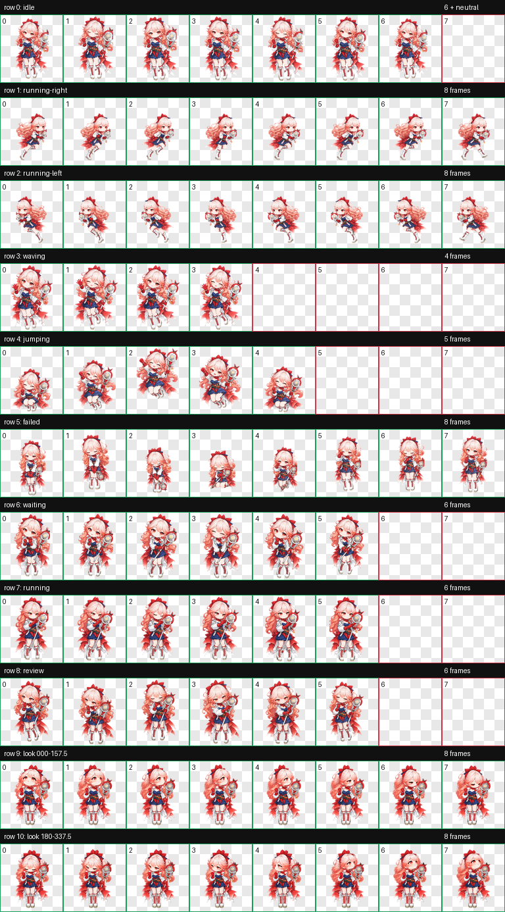

# Haruka Codex Pet

Haruka is a custom Codex v2 animated pet inspired by the supplied Arknights character reference.

## Install on Windows

Copy `pet.json` and `spritesheet.webp` into:

```text
C:\Users\<username>\.codex\pets\haruka\
```

Then open **Settings > Pets**, select **Refresh**, and choose **Haruka**.

## Package

- Sprite version: 2
- Atlas: 1536 x 2288 WebP with transparency
- Grid: 8 columns x 11 rows
- Standard animations: idle, move right, move left, wave, jump, failed, waiting, running, and review
- Look directions: 16 directions in 22.5-degree steps



## Files

- `pet.json`: Codex pet manifest
- `spritesheet.webp`: installable animation atlas
- `contact-sheet.png`: animation overview
- `look-directions.png`: direction overview
- `previews/`: GIF previews for standard animation states
- `validation.json`: v2 atlas validation result

This is a personal fan-made custom pet. Character rights belong to their respective owners.
